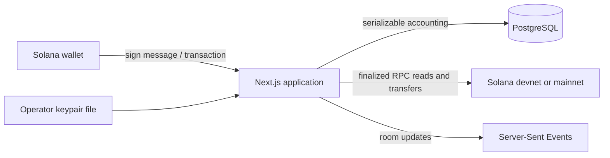

# PoolRaid


PoolRaid is a self-hosted Solana game application with two modes: pooled scratch cards and peer coin flips. It combines a Next.js interface, PostgreSQL accounting, wallet-signature sessions, finalized on-chain deposits, verifiable server-seed commitments, and retryable SOL payouts.

> [!CAUTION]
> This repository is experimental software, not a hosted service or a smart contract. The operator controls a hot wallet and the game server. Review the security model, local laws, and operating procedures before using real funds. Devnet is the default.

## What is included

- Six scratch-card tiers with three independently derived result zones
- Ten coin-flip tiers and six persistent rooms per tier
- SHA-256 seed commitments and public result-verification pages
- Exact `BigInt` lamport accounting in PostgreSQL
- Exact deposit matching by sender, recipient, amount, memo, and finality
- Wallet-signature authentication with replay-resistant nonces
- Durable, idempotent payout records and signed-transaction retries
- Player profiles, achievements, XP, referrals, leaderboards, and self-exclusion
- Admin controls for pauses, pool allocation, giveaways, and house withdrawals
- Docker, a clean baseline migration, CI, and unit tests

## Architecture at a glance



There is no PoolRaid Solana program. Deposits and payouts are ordinary System Program transfers. The database is the application ledger, while one operator-controlled wallet holds the corresponding SOL. See [Architecture](docs/ARCHITECTURE.md) and [Security model](docs/SECURITY_MODEL.md).

## Quick start on devnet

Requirements: Node.js 22+, npm, Docker, a Solana keypair funded with devnet SOL, and a wallet that supports message signing.

```bash
cp .env.example .env
docker compose up -d postgres
npm install
npm run db:generate
npm run db:migrate
npm run db:seed
npm run dev
```

Before starting the app, edit `.env`:

- Set `AUTH_SECRET` and `MAINTENANCE_SECRET` to separate random values.
- Set `POOL_WALLET_KEYPAIR_FILE` to an absolute path outside this repository. Solana CLI JSON keypair files and base58 secrets are supported.
- Set `ADMIN_WALLET` to the public key allowed to open an admin session.
- Keep all Solana network variables on `devnet` until the full deployment checklist is complete.

Open `http://localhost:3000`. The Prisma seed creates empty scratch pools and 60 empty coin-flip rooms; it does not fund the wallet or allocate pool liquidity.

## Commands

| Command | Purpose |
| --- | --- |
| `npm run dev` | Start the development server |
| `npm run build` | Create a production build |
| `npm run lint` | Run ESLint |
| `npm run typecheck` | Run TypeScript without emitting files |
| `npm test` | Run unit tests |
| `npm run test:coverage` | Run tests with coverage |
| `npm run db:generate` | Generate the Prisma client |
| `npm run db:migrate` | Apply committed migrations |
| `npm run db:seed` | Idempotently seed configs, pools, and rooms |
| `npm run check` | Run lint, types, tests, and build |

## Documentation

- [Architecture](docs/ARCHITECTURE.md)
- [Game mechanics](docs/GAME_MECHANICS.md)
- [Fairness and verification](docs/FAIRNESS.md)
- [API reference](docs/API.md)
- [Security model](docs/SECURITY_MODEL.md)
- [Deployment](docs/DEPLOYMENT.md)
- [Operations](docs/OPERATIONS.md)
- [Design system](docs/DESIGN_SYSTEM.md)
- [Public release checklist](docs/PUBLICATION.md)

## Mainnet policy

Mainnet is opt-in. Set both the public and server RPC/network variables deliberately, mount the production keypair read-only, run only one application replica unless the SSE and job coordination layers have been externalized, configure the maintenance job, reconcile the database ledger with the wallet, and arrange an independent security review. The repository does not make a deployment lawful in any jurisdiction.

## Contributing and security

Read [CONTRIBUTING.md](CONTRIBUTING.md) before opening a pull request. Do not report vulnerabilities in public issues; follow [SECURITY.md](SECURITY.md).

## License

PoolRaid source and repository assets are available under the [ISC License](LICENSE). Installed third-party dependencies retain their own licenses.
