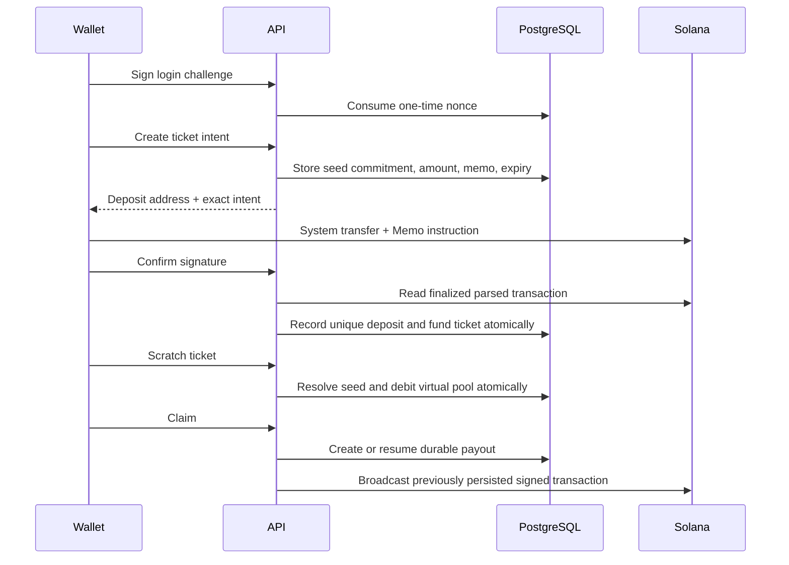

# Architecture

PoolRaid is a server-operated web application. It does not deploy or call a custom Solana program.

## Components

| Component | Responsibility |
| --- | --- |
| Next.js App Router | UI, API routes, wallet sessions, game orchestration, verification pages |
| PostgreSQL + Prisma | Authoritative application ledger, intents, pool allocation, rooms, profiles, nonces, payouts |
| Solana RPC | Finalized deposit reads, blockhashes, balance checks, transaction broadcast and confirmation |
| Operator keypair | Signs payouts from the shared hot wallet; never belongs in the repository or database |
| SSE broadcaster | Sends room updates to connected clients in the current Node.js process |
| Maintenance request | Expires reservations, refunds stale rooms, completes stuck flips, and retries payouts |

## Scratch lifecycle

## Coin-flip lifecycle

The first player reserves a room before paying. The reservation binds the wallet, room, side, amount, memo, and expiry. After exact deposit confirmation, the server generates and exposes the seed commitment. The second player's reservation is confirmed the same way. The result is derived from the committed seed, both wallet addresses, and room ID. A completed flip creates a history record and an idempotent payout.

Room states are `empty`, `reserving`, `waiting`, `matching`, `matched`, `flipping`, `completed`, and `refunding`. Timers improve presentation only; the maintenance endpoint is the recovery path after restarts.

## Accounting

All stored values of money are integer lamports. Scratch pools and house profit are virtual allocations inside one on-chain wallet. Serializable transactions protect multi-row mutations. `Deposit.signature`, deposit purpose/reference, payout business keys, and signed transaction signatures are unique replay barriers.

## Scaling constraints

The SSE listener map and flip timers are process-local. Run one application replica. Before horizontal scaling, move broadcasts to Redis or another pub/sub system and move transitions/maintenance to a single durable job queue. PostgreSQL and Solana RPC must also be provisioned for the desired concurrency.
